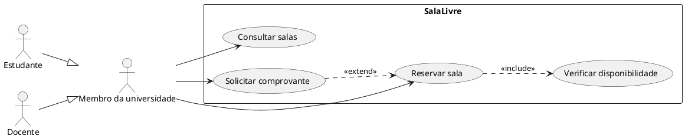
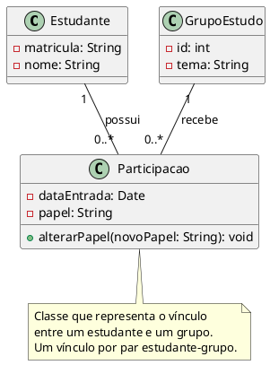
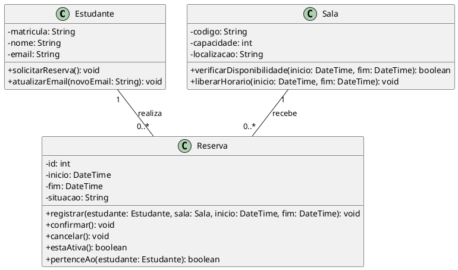
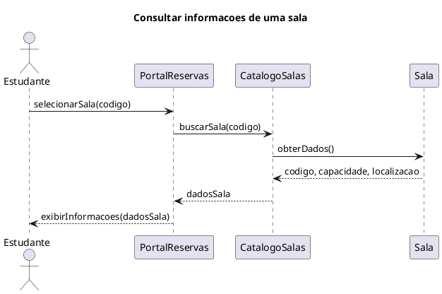
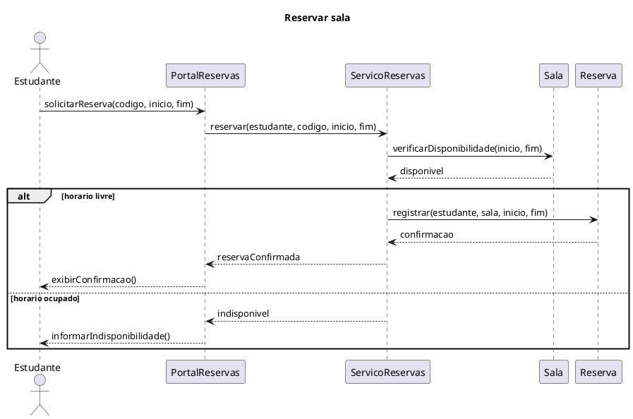
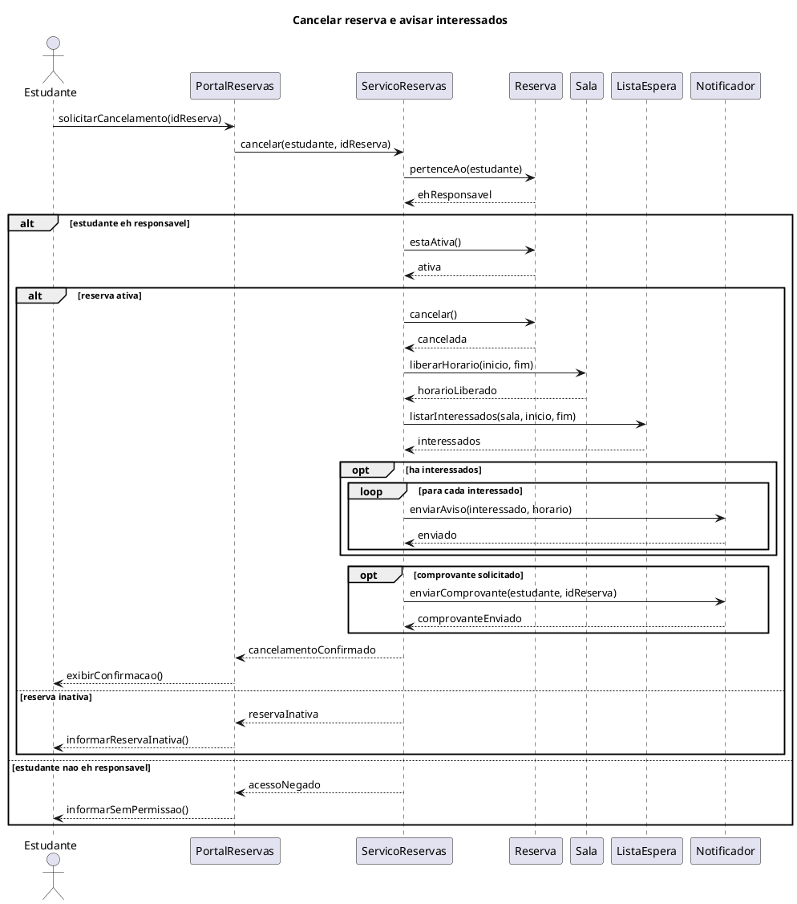

# Gabarito Comentado — Revisão de UML

**Abrange:** Casos de Uso, Classes e Sequência  
**Referência:** [Lista de revisão](Lista_Revisao_UML_Casos_Classes_Sequencia.md)

> **Orientação para correção:** em questões de modelagem, pode haver mais de uma solução correta. Considere válidas propostas que respeitem a notação UML, o enunciado, as multiplicidades, as responsabilidades e as regras do domínio. Os diagramas abaixo são **soluções de referência**, não os únicos desenhos possíveis.

---

# Parte I — Diagrama de Casos de Uso

## Questão 1 — Finalidade do diagrama

O Diagrama de Casos de Uso representa **funcionalidades/serviços observáveis do sistema do ponto de vista de atores externos**. Um **ator** é um papel externo que interage com o sistema (pessoa, organização ou outro sistema). Um **caso de uso** é um serviço ou objetivo oferecido pelo sistema ao ator. Um botão e uma tela normalmente são elementos de interface e não, por si só, objetivos do usuário.

**Exemplo:** `Reservar sala` é um caso de uso; `Clicar em confirmar` é uma ação de interface dentro de um fluxo.

## Questão 2 — `include` e `extend`

- **`<<include>>`**: o comportamento incluído é incorporado obrigatoriamente ao fluxo do caso de uso de origem quando a inclusão é alcançada. A **seta sai do caso base e aponta para o caso incluído**. Exemplo: `Reservar sala` → `Verificar disponibilidade`.
- **`<<extend>>`**: acrescenta comportamento **condicional/opcional** a um caso de uso base em um ponto de extensão. A **seta sai do caso que estende e aponta para o caso base**. Exemplo: `Solicitar comprovante` → `Reservar sala`.

Não é a presença de uma seta, mas o **significado do vínculo** que diferencia ambos os relacionamentos.

## Questão 3 — Generalização de atores

A generalização indica que um ator especializado **herda as interações** do ator mais geral. Exemplo: `MembroUniversidade` pode `Consultar salas`; `Estudante` e `Docente`, como especializações, também podem executar essa interação.

A **seta com triângulo vazado aponta para o ator mais genérico**:

```text
Estudante ─────▷ MembroUniversidade
Docente   ─────▷ MembroUniversidade
```

O ator genérico descreve um papel comum, não uma classe de software.

## Questão 4 — Fronteira do sistema

A fronteira delimita **o que será responsabilidade do sistema modelado**. Os casos de uso ficam dentro dela, enquanto atores externos ficam fora. Um serviço de pagamento/e-mail **externo** ao sistema sob análise é um **ator secundário** que interage com um caso de uso interno, como `Processar pagamento` ou `Enviar comprovante`. Caso essa funcionalidade faça parte do próprio sistema sob análise, ela pode ser modelada de outra forma, desde que o limite esteja claro.

## Questão 5 — Casos de uso do SalaLivre

**Uma resposta possível:**

| Ator principal | Caso de uso | Resultado esperado |
|---|---|---|
| Estudante | Consultar salas | Visualiza salas e seus dados. |
| Estudante | Consultar disponibilidade | Conhece os horários livres para uma sala. |
| Estudante | Reservar sala | Obtém uma reserva confirmada em horário disponível. |
| Estudante | Cancelar reserva | Cancela uma reserva própria ativa. |
| Estudante | Solicitar comprovante | Recebe comprovante de reserva por e-mail. |

Também são possíveis casos de uso ligados à participação em grupos de estudo, caso os alunos explicitem um objetivo observável do estudante.

## Questão 6 — Diagrama com generalização, `include` e `extend`

Uma solução em PlantUML:



**Conferência:** o ator especializado aponta para o genérico; `include` parte de `Reservar sala` e aponta para `Verificar disponibilidade`; `extend` parte de `Solicitar comprovante` e aponta para `Reservar sala`.

## Questão 7 — Classificação dos relacionamentos

**a)** **`<<include>>`**: `Reservar sala` → `Verificar disponibilidade`, pois a verificação é obrigatória no fluxo da reserva.  
**b)** **`<<extend>>`**: `Emitir comprovante` → `Reservar sala`, pois o comprovante é opcional.  
**c)** **Generalização**: `Docente` → `MembroUniversidade`, com triângulo vazado apontando para o ator genérico.  
**d)** **Associação**: ligação de participação entre o ator `Estudante` e o caso de uso `Consultar salas`.

## Questão 8 — Três problemas e correções

| Relação apresentada | Problema | Correção |
|---|---|---|
| `Reservar sala ..> Verificar disponibilidade : <<extend>>` | A disponibilidade é verificada obrigatoriamente. | `Reservar sala ..> Verificar disponibilidade : <<include>>` |
| `Emitir comprovante ..> Reservar sala : <<include>>` | O comprovante é opcional. | `Emitir comprovante ..> Reservar sala : <<extend>>` |
| `MembroUniversidade --|> Docente` | A generalização está invertida. | `Docente --|> MembroUniversidade` |

---

# Parte II — Diagrama de Classes

## Questão 9 — Classe, atributo e método

- **Classe:** abstração de um conjunto de objetos com características e comportamentos comuns.
- **Atributo:** propriedade ou informação mantida pela classe.
- **Método:** operação/comportamento que os objetos da classe podem executar.

**Exemplo:** classe `Sala`; atributos `codigo: String` e `capacidade: int`; método `verificarDisponibilidade(inicio: DateTime, fim: DateTime): boolean`.

## Questão 10 — Multiplicidades

| Multiplicidade | Significado |
|---|---|
| `1` | Exatamente um. |
| `0..1` | Zero ou um. |
| `0..*` | Zero ou muitos. |
| `1..*` | Um ou muitos. |

No SalaLivre, **cada `Reserva` se relaciona a exatamente um `Estudante`** (`1`), enquanto **cada `Estudante` pode possuir zero ou muitas `Reservas`** (`0..*`). O mesmo vale para `Sala` e `Reserva`.

## Questão 11 — Modificadores de visibilidade

| Símbolo | Visibilidade | Acesso |
|---|---|---|
| `+` | Público (`public`) | Qualquer classe que possa acessar o objeto/tipo. |
| `-` | Privado (`private`) | Apenas dentro da própria classe. |
| `#` | Protegido (`protected`) | Pela classe e por suas subclasses. |
| `~` | Pacote (`package`) | Por elementos pertencentes ao mesmo pacote. |

**Encapsulamento:** restringir acesso direto aos dados internos ajuda a preservar invariantes e faz com que mudanças de estado aconteçam por operações controladas.

## Questão 12 — Relacionamentos e classe associativa

- **Associação:** ligação estrutural entre classes, por exemplo `Estudante` — `Reserva`.
- **Agregação (losango vazio):** relação todo–parte **fraca/compartilhada**, sem dependência rígida de ciclo de vida. Exemplo didático: `Equipe` agrega `Membro` (o membro pode existir independentemente da equipe).
- **Composição (losango preenchido):** relação todo–parte **forte**, com pertencimento exclusivo e ciclo de vida vinculado ao todo, por exemplo `Pedido` composto de `ItemPedido`, se os itens forem definidos como dependentes daquele pedido.
- **Generalização:** relação de especialização/herança, como `Pessoa` ← `Estudante`.
- **Classe associativa:** classe ligada a uma **associação** para registrar dados próprios do vínculo. No SalaLivre, `Participacao` relaciona `Estudante` e `GrupoEstudo` e registra `dataEntrada` e `papel`.

**Nota:** agregação/composição não devem ser usadas automaticamente para toda relação um-para-muitos; dependem da semântica do domínio.

## Questão 13 — Três classes, atributos e métodos

**Uma resposta possível:**

| Classe | Atributos | Métodos | Justificativa |
|---|---|---|---|
| `Estudante` | `matricula: String`, `nome: String`, `email: String` | `solicitarReserva()`, `atualizarEmail()` | Representa pessoa do domínio, com estado e comportamento. |
| `Sala` | `codigo: String`, `capacidade: int`, `localizacao: String` | `verificarDisponibilidade()`, `liberarHorario()` | Representa um espaço que pode ser reservado. |
| `Reserva` | `id: int`, `inicio: DateTime`, `fim: DateTime`, `situacao: String` | `confirmar()`, `cancelar()` | Representa a reserva e seu ciclo de vida. |

Métodos e tipos equivalentes são aceitáveis, desde que coerentes com o cenário.

## Questão 14 — Multiplicidades

**a) Estudante–Reserva:**

`Estudante "1" -- "0..*" Reserva`: cada reserva tem um estudante; um estudante pode ter várias reservas.

**b) Sala–Reserva:**

`Sala "1" -- "0..*" Reserva`: cada reserva se refere a uma sala; uma sala pode ter várias reservas em horários diferentes.

**c) Estudante–GrupoEstudo:**

`Estudante "0..*" -- "0..*" GrupoEstudo`: um estudante pode participar de vários grupos e um grupo pode ter vários estudantes. Os atributos `dataEntrada` e `papel` pertencem ao **vínculo específico estudante–grupo**, não ao estudante nem ao grupo isoladamente. Por isso são próprios de `Participacao`.

## Questão 15 — Classe associativa `Participacao`

**Modelo semântico esperado:**

- `Estudante` e `GrupoEstudo` têm relação muitos-para-muitos.
- `Participacao` registra propriedades dessa associação (`dataEntrada`, `papel`).
- Cada instância de `Participacao` corresponde ao vínculo entre **um estudante e um grupo**, e, neste cenário, existe **no máximo um vínculo por par**.

Uma forma válida de representar a mesma informação por uma classe intermediária em PlantUML é:



Na **notação formal de classe associativa**, `Participacao` pode aparecer ligada por uma **linha tracejada à associação** `Estudante`—`GrupoEstudo`. O importante é não confundir `Participacao` com um simples atributo de um dos dois lados.

## Questão 16 — Diagrama de Classes para as reservas

Solução de referência em PlantUML:



**O que conferir:** pelo menos três atributos por classe; pelo menos um método; visibilidade; cardinalidade `1` do lado de `Estudante` e `Sala` para cada `Reserva`; cardinalidade `0..*` para o conjunto de reservas de cada um.

**Observação:** não seria correto inserir herança sem justificar uma relação real de especialização.

---

# Parte III — Diagrama de Sequência

## Questão 17 — Finalidade e tempo

O Diagrama de Sequência representa **as interações entre participantes ao longo do tempo durante um cenário específico**. Uma **lifeline** é a linha vertical que indica a existência/participação de um objeto ou ator durante a interação. O tempo progride **de cima para baixo**.

Enquanto o Diagrama de Classes representa a **estrutura estática** (classes, propriedades, operações e relações), o Diagrama de Sequência representa **colaboração e ordem de mensagens em uma execução**.

## Questão 18 — Chamadas, retornos e ativação

Uma **chamada** solicita a execução de uma operação (mensagem síncrona usualmente com linha contínua e ponta preenchida). Um **retorno** comunica o resultado ou o encerramento de uma chamada (usualmente linha tracejada com ponta aberta). Em PlantUML, `A -> B: operacao()` e `B --> A: resposta` são notações textuais comuns para esses casos. A **barra de ativação** indica o intervalo no qual o participante está executando uma operação.

**Ressalva:** UML também permite mensagens assíncronas; portanto, a forma da ponta da seta depende da semântica da mensagem, e não apenas do fato de ser uma chamada.

## Questão 19 — `alt`, `opt`, `loop`

- **`alt`:** um de vários caminhos alternativos. Exemplo: se houver vaga, confirmar reserva; caso contrário, informar indisponibilidade.
- **`opt`:** executa um bloco somente quando uma condição for verdadeira. Exemplo: enviar comprovante se solicitado.
- **`loop`:** repete mensagens enquanto a condição se aplicar. Exemplo: avisar cada estudante na lista de espera.

Um **`alt` aninhado** é adequado quando há uma segunda decisão condicionada à primeira, por exemplo: primeiro verificar se o estudante é dono da reserva e, **apenas se for**, verificar se ela está ativa.

## Questão 20 — Consistência entre diagramas

Se o Diagrama de Sequência contém `Sala.verificarDisponibilidade()`, o Diagrama de Classes deve prever essa operação em `Sala` (ou a equipe deve justificar uma responsabilidade de serviço equivalente). Essa coerência permite entender **quem executa o quê** e reduz contradições entre modelos.

**Interfaces e serviços** podem aparecer no Diagrama de Sequência como participantes de controle/limite do sistema mesmo quando o Diagrama de Classes produzido em aula está restrito às **classes de domínio**. Não é necessário incluir todo componente técnico em um modelo conceitual de domínio.

## Questão 21 — Sequência simples: consultar sala



O fluxo é linear e possui retornos explicitados. Não há decisão ou repetição.

## Questão 22 — Sequência intermediária: reservar sala



**O que conferir:** a disponibilidade é consultada **antes** de decidir; `Reserva.registrar()` só acontece no caminho livre; o retorno ao estudante depende do resultado.

## Questão 23 — Sequência elaborada: cancelar e avisar interessados



**O que conferir:**

1. O teste de titularidade ocorre antes de qualquer cancelamento.
2. A situação da reserva só é verificada quando o usuário é autorizado.
3. Liberação de horário e avisos só aparecem após cancelamento bem-sucedido.
4. `loop` está dentro do `opt` que representa a existência de interessados.
5. O comprovante é opcional e não bloqueia a lógica de cancelamento no modelo apresentado.
6. Cada caminho de erro informa a razão correspondente.

## Questão 24 — Integração entre os três diagramas

**a) Casos de Uso:** ator `Estudante`; caso de uso principal `Reservar sala`, que **inclui** `Verificar disponibilidade`. A opção `Solicitar comprovante` pode **estender** `Reservar sala`.

**b) Classes:** `Estudante`, `Sala` e `Reserva` (além de elementos técnicos, caso modelados). Exemplos de métodos: `Sala.verificarDisponibilidade()` e `Reserva.confirmar()`; uma instância de `Reserva` associa **um estudante** a **uma sala**, com data, horário e situação.

**c) Sequência:** `Estudante` solicita reserva ao `PortalReservas`; o portal encaminha ao `ServicoReservas`; o serviço consulta `Sala.verificarDisponibilidade()`. Um `alt` distingue horário livre (registrar e confirmar `Reserva`) de horário ocupado (informar erro).

**Por que são complementares?** O Diagrama de Casos de Uso apresenta **o objetivo do ator e as funcionalidades externas**; o Diagrama de Classes apresenta **as estruturas, operações e relacionamentos**; o Diagrama de Sequência apresenta **como os participantes trocam mensagens ao realizar o cenário**, inclusive sua ordem e condições.

---

## Síntese para revisão

| Diagrama | Pergunta central | Elementos típicos |
|---|---|---|
| **Casos de Uso** | O que o sistema oferece e para quem? | Atores, casos de uso, fronteira, associações, `include`, `extend`, generalização. |
| **Classes** | Como as entidades e responsabilidades estão estruturadas? | Classes, atributos, operações, visibilidade, multiplicidades e relacionamentos. |
| **Sequência** | Quem interage com quem, em qual ordem, num cenário? | Lifelines, mensagens, retornos, ativações, `alt`, `opt`, `loop`. |

> **Observação final:** o gabarito apresenta respostas de referência. Desenhos diferentes são aceitáveis quando expressam corretamente a mesma semântica do cenário e respeitam a notação UML.
