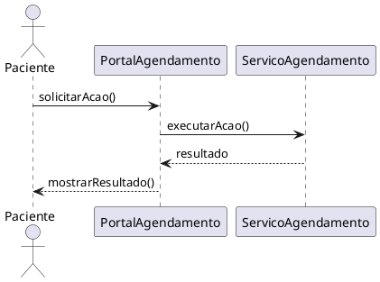

# Lista de Revisão Integrada — Casos de Uso, Classes e Sequência

**Disciplina:** Engenharia de Software  
**Tema:** Modelagem UML de um mesmo sistema  
**Ferramentas sugeridas:** diagrams.net (Draw.io) para casos de uso e classes; [PlantUML online](https://www.plantuml.com/plantuml/uml/) para os diagramas de sequência.

## Objetivo

Nesta atividade, você produzirá **três tipos de diagrama UML para um único sistema**, partindo de uma descrição textual:

1. **Diagrama de Casos de Uso:** identificar atores, funcionalidades e relações de `include`, `extend` e generalização.
2. **Diagrama de Classes:** representar os conceitos do sistema, seus atributos, métodos e relacionamentos.
3. **Diagramas de Sequência:** representar três cenários de execução, utilizando **os mesmos atores e classes** identificados nas etapas anteriores.

O trabalho deve ser **coerente entre os diagramas**. Uma funcionalidade indicada no Diagrama de Casos de Uso deve ser compatível com as responsabilidades das classes; uma mensagem de um Diagrama de Sequência deve corresponder a uma operação de uma classe participante.

> **Importante:** o sistema é fictício. Não é necessário programá-lo. O objetivo é produzir os modelos UML.

---

# Parte 1 — Identificação dos atores e casos de uso

## 1. Contexto do sistema: Clínica ConectaSaúde

A clínica **ConectaSaúde** deseja implantar um sistema para que consultas sejam agendadas sem depender de contatos telefônicos ou anotações em papel. A clínica oferece **consultas presenciais** e **teleconsultas**, ambas sujeitas à disponibilidade de horário dos médicos.

O sistema atende aos seguintes perfis:

- **Agendador:** papel geral de quem solicita um agendamento. Nenhuma pessoa utiliza o sistema diretamente como um “Agendador genérico”: esse papel é exercido por **pacientes** ou por **recepcionistas**.
- **Paciente:** pode consultar horários disponíveis e agendar consultas para si mesmo.
- **Recepcionista:** pode consultar horários e realizar agendamentos em nome de um paciente já cadastrado.
- **Médico:** utiliza o sistema para consultar sua agenda de atendimentos. Ele não precisa executar os casos de uso de agendamento para realizar essa consulta.

**Atenção:** `Paciente` e `Recepcionista` são dois tipos específicos do papel **Agendador**. Portanto, compartilham as funcionalidades atribuídas a esse papel. `Médico` é um ator independente.

## 2. Funcionalidades do sistema

### UC01 — Consultar horários disponíveis

O **Agendador** pode escolher um médico e informar um período para visualizar os horários disponíveis. O sistema deve apresentar os horários livres registrados na agenda daquele médico.

### UC02 — Agendar consulta

O **Agendador** pode solicitar uma consulta para um paciente. O agendamento utiliza um médico e um horário selecionados, e só pode ser confirmado quando esse horário estiver livre.

Antes de **todo agendamento**, o sistema executa obrigatoriamente a verificação de disponibilidade. O agendamento não pode prosseguir diretamente para a confirmação sem essa verificação.

“Agendar consulta” é a funcionalidade **geral**. Existem duas maneiras específicas de realizá-la, descritas a seguir, que preservam as regras comuns do agendamento.

### UC03 — Agendar consulta presencial

É uma modalidade específica de **Agendar consulta**. Quando o horário estiver disponível, o sistema registra uma consulta do tipo **presencial**. O paciente deverá comparecer à clínica no horário marcado.

### UC04 — Agendar teleconsulta

Também é uma modalidade específica de **Agendar consulta**. Quando o horário estiver disponível, o sistema registra uma consulta do tipo **teleconsulta** e gera um **link de acesso virtual**, que será apresentado na confirmação.

### UC05 — Verificar disponibilidade

O sistema verifica se um horário específico, na agenda de determinado médico, está livre. A verificação é **necessária em toda execução** de agendamento, independentemente de a consulta ser presencial ou remota.

### UC06 — Solicitar lembrete

Depois que uma consulta é **confirmada**, o agendador pode **optar** por receber um lembrete antes do atendimento. Quando essa opção é escolhida, o sistema programa uma notificação associada à consulta.

Solicitar lembrete **não é obrigatório**: uma consulta pode ser agendada e confirmada sem que essa funcionalidade seja executada. A possibilidade de solicitar lembrete surge no momento de confirmação do agendamento.

### UC07 — Consultar agenda do médico

O **Médico** pode escolher uma data e consultar os atendimentos marcados em sua agenda, incluindo horário, paciente e modalidade da consulta.

## 3. Atividade — Diagrama de Casos de Uso

Com base nas descrições anteriores, construa **um Diagrama de Casos de Uso UML** para o sistema ConectaSaúde.

Seu diagrama deve representar:

1. Os **quatro papéis de ator** descritos, respeitando a relação entre o papel geral e os dois tipos específicos.
2. Os **sete casos de uso** (UC01 a UC07), sem inventar funcionalidades adicionais.
3. As associações entre cada ator e as funcionalidades que pode executar.
4. A relação entre **Agendar consulta** e **Verificar disponibilidade**, considerando que a verificação sempre acontece.
5. A relação entre **Solicitar lembrete** e o processo de agendamento, considerando que o lembrete é opcional e ocorre apenas após confirmação.
6. A relação de **generalização/especialização entre os casos de uso** de agendamento.
---

# Parte 2 — Descrição das classes organizada por caso de uso

## 4. Como utilizar esta seção

As descrições seguintes mostram **quais classes participam de cada caso de uso** e quais informações e operações pertencem a elas. **Uma classe pode aparecer em vários casos de uso**, mas deve ser desenhada **uma única vez** no Diagrama de Classes.

Para evitar inconsistências, utilize **exatamente os nomes das classes e das operações indicados**. Os atributos podem receber tipos apropriados (por exemplo, `String`, `Date`, `DateTime`, `Boolean` ou `Integer`).

**Há 10 classes distintas descritas nesta seção:** `Agendador`, `Paciente`, `Recepcionista`, `Medico`, `Agenda`, `Horario`, `Consulta`, `PortalAgendamento`, `ServicoAgendamento` e `Notificacao`.

### 4.1. UC01 — Consultar horários disponíveis

Para permitir a consulta, são necessárias as seguintes classes:

| Classe | Atributos relevantes | Métodos relevantes | Responsabilidade |
|---|---|---|---|
| `Agendador` *(abstrata)* | `id`, `nome`, `email` | `atualizarContato()` | Representar dados comuns aos perfis que podem agendar. |
| `Paciente` | `cpf`, `dataNascimento` | `consultarDados()` | Representar o paciente; herda os dados comuns de `Agendador`. |
| `Recepcionista` | `matricula` | `consultarDadosProfissionais()` | Representar quem agenda em nome do paciente; herda os dados comuns de `Agendador`. |
| `Medico` | `id`, `nome`, `crm`, `especialidade` | `obterAgenda()` | Disponibilizar a agenda do profissional. |
| `Agenda` | `id` | `listarHorarios(periodo)`, `listarHorariosDisponiveis(periodo)`, `localizarHorario(dataHora)`, `listarConsultas(data)` | Organizar os horários e atendimentos de um médico. |
| `Horario` | `id`, `dataHora`, `disponivel` | `estaDisponivel()`, `marcarOcupado()` | Representar um horário agendável. |
| `PortalAgendamento` | `nomeSistema` | `consultarHorarios(idMedico, periodo)`, `exibirHorarios(listaHorarios)`, `exibirConfirmacao(mensagem)`, `exibirErro(mensagem)` | Receber comandos do ator e apresentar informações. |
| `ServicoAgendamento` | `idServico` | `consultarHorarios(idMedico, periodo)` | Coordenar a consulta e devolver os horários ao portal. |

**Regras estruturais:** cada médico possui **uma agenda**, e cada agenda pertence a **um único médico**. Uma agenda possui **vários horários**; cada horário pertence a **uma única agenda**.

A classe `Agendador` **não representa um usuário concreto**: é uma superclasse de `Paciente` e `Recepcionista`.

### 4.2. UC02 — Agendar consulta (comportamento geral)

A funcionalidade geral reúne elementos compartilhados pelos dois tipos de consulta:

| Classe | Atributos relevantes | Métodos relevantes | Responsabilidade |
|---|---|---|---|
| `Paciente` | `cpf`, `dataNascimento` | `consultarDados()` | Identificar o paciente para quem a consulta será marcada. |
| `Medico` | `id`, `nome`, `crm`, `especialidade` | `obterAgenda()` | Identificar o médico e disponibilizar sua agenda. |
| `Agenda` | `id` | `localizarHorario(dataHora)` | Localizar o horário selecionado. |
| `Horario` | `id`, `dataHora`, `disponivel` | `estaDisponivel()`, `marcarOcupado()` | Verificar e ocupar o horário. |
| `Consulta` | `id`, `tipo`, `status`, `linkAcesso` | `confirmar()`, `gerarLinkAcesso()` | Registrar a consulta e seu estado. |
| `PortalAgendamento` | `nomeSistema` | `solicitarAgendamento(idPaciente, idMedico, idHorario, tipo)`, `exibirConfirmacao(mensagem)`, `exibirErro(mensagem)` | Receber o pedido e mostrar o resultado. |
| `ServicoAgendamento` | `idServico` | `verificarDisponibilidade(idHorario)`, `agendarPresencial(idPaciente, idMedico, idHorario)`, `agendarTeleconsulta(idPaciente, idMedico, idHorario)`, `cadastrarLembrete(idConsulta)` | Coordenar as regras de agendamento. |

**Regras estruturais:** uma `Consulta` pertence a **um paciente**, **um médico** e **um horário**. Um paciente pode ter várias consultas; um médico pode atender várias consultas. Um horário pode não estar ocupado ou estar associado a **uma consulta**. O campo `tipo` de `Consulta` distingue as modalidades `presencial` e `teleconsulta`.

> **Importante:** as duas modalidades utilizam **a mesma classe `Consulta`**. Não crie classes extras `ConsultaPresencial` ou `Teleconsulta` apenas porque existem dois casos de uso especializados.

### 4.3. UC03 — Agendar consulta presencial

O agendamento presencial reutiliza os elementos apresentados para CU02.

- `PortalAgendamento` recebe a escolha de **consulta presencial** e chama `solicitarAgendamento(..., tipo)`.
- `ServicoAgendamento` executa `agendarPresencial(...)`.
- `Medico` e `Agenda` permitem localizar o horário.
- `Horario` informa sua disponibilidade por `estaDisponivel()` e, após confirmação, registra a ocupação por `marcarOcupado()`.
- `Consulta` é criada com `tipo = presencial` e confirmada por `confirmar()`.
- `Paciente` identifica a pessoa atendida.

**Não se gera link virtual** para a consulta presencial.

### 4.4. UC04 — Agendar teleconsulta

A teleconsulta usa as mesmas classes e regras de CU02, mas acrescenta uma responsabilidade:

- `PortalAgendamento` recebe a escolha de **teleconsulta** e chama `solicitarAgendamento(..., tipo)`.
- `ServicoAgendamento` executa `agendarTeleconsulta(...)`.
- `Medico` e `Agenda` permitem localizar o horário.
- `Horario` é consultado e ocupado quando livre.
- `Consulta` é criada com `tipo = teleconsulta`, é confirmada com `confirmar()` e utiliza `gerarLinkAcesso()` para produzir o endereço virtual, armazenado no atributo `linkAcesso`.
- `Paciente` é associado ao atendimento.

**Regra:** a emissão do link ocorre apenas quando a teleconsulta é confirmada.

### 4.5. UC05 — Verificar disponibilidade

Esse comportamento é necessário para qualquer modalidade de agendamento.

| Classe | Métodos utilizados | Responsabilidade |
|---|---|---|
| `ServicoAgendamento` | `verificarDisponibilidade(idHorario)` | Solicitar a checagem antes de confirmar uma consulta. |
| `Medico` | `obterAgenda()` | Fornecer a agenda do médico selecionado. |
| `Agenda` | `localizarHorario(dataHora)` | Localizar o horário correto. |
| `Horario` | `estaDisponivel()` | Informar `true` se o horário estiver livre e `false` se estiver ocupado. |

Se a resposta for `false`, o agendamento não é confirmado e a interface deve informar a indisponibilidade.

### 4.6. UC06 — Solicitar lembrete

O lembrete é opcional, sendo oferecido após a confirmação do agendamento.

| Classe | Atributos relevantes | Métodos relevantes | Responsabilidade |
|---|---|---|---|
| `Consulta` | `id`, `tipo`, `status`, `linkAcesso` | `confirmar()` | Identificar a consulta confirmada. |
| `Notificacao` | `id`, `canal`, `dataProgramada`, `status` | `programarLembrete(idConsulta)` | Registrar um lembrete associado à consulta. |
| `ServicoAgendamento` | `idServico` | `cadastrarLembrete(idConsulta)` | Coordenar a solicitação do lembrete. |
| `PortalAgendamento` | `nomeSistema` | `solicitarLembrete(idConsulta)`, `exibirConfirmacao(mensagem)` | Receber a escolha do agendador e confirmar a programação. |

**Regra estrutural:** uma consulta pode não ter lembrete ou ter **um** lembrete programado; cada lembrete pertence a **uma consulta**.

### 4.7. UC07 — Consultar agenda do médico

Para consultar seus atendimentos, o médico utiliza as classes:

| Classe | Métodos utilizados | Responsabilidade |
|---|---|---|
| `Medico` | `obterAgenda()` | Localizar a própria agenda. |
| `Agenda` | `listarConsultas(data)` | Retornar as consultas daquela data. |
| `Consulta` | `confirmar()` *(já definida)* | Fornecer seus dados armazenados para a listagem; não é necessário criar um novo método para isso. |
| `PortalAgendamento` | `consultarAgendaMedico(idMedico, data)`, `exibirAgenda(listaConsultas)` | Receber a consulta do médico e apresentar os atendimentos. |
| `ServicoAgendamento` | `consultarAgendaMedico(idMedico, data)` | Coordenar a consulta aos atendimentos. |

**Observação:** `Consulta` já contém `id`, `tipo` e `status`; sua associação com `Paciente` permite identificar o paciente na listagem.

## 5. Atividade — Diagrama de Classes

Com base nas descrições **organizadas por caso de uso**, construa **um único Diagrama de Classes UML** contendo as **10 classes distintas** descritas.

O diagrama deverá apresentar:

1. Nome das classes, **atributos** e **métodos**.
2. Indicação de que `Agendador` é uma **classe abstrata**.
3. **Herança** de `Paciente` e `Recepcionista` a partir de `Agendador`.
4. Associação entre `Medico` e `Agenda`.
5. Associação entre `Agenda` e `Horario`.
6. Associação de `Consulta` com `Paciente`, `Medico` e `Horario`.
7. Associação opcional entre `Consulta` e `Notificacao`.
8. Dependências de uso de `PortalAgendamento` e `ServicoAgendamento` com as classes que manipulam, quando apropriado.
9. **Multiplicidades** nas associações relevantes.

# Parte 3 — Três cenários para Diagramas de Sequência

## 6. Instruções comuns aos três cenários

Construa **três Diagramas de Sequência UML em PlantUML**, um para cada cenário abaixo.

Os participantes devem ser **atores já identificados na Parte 1** e **instâncias das classes definidas na Parte 2**. Você **não deve criar** novos participantes, como `BancoDeDados`, `Controller`, `API`, `TelaConsulta` ou `Sistema`, porque eles não foram descritos no Diagrama de Classes desta atividade.

**Convenção:** no Diagrama de Sequência, o ator (`Paciente`, `Recepcionista` ou `Medico`) representa a pessoa que inicia a interação. Os objetos (`PortalAgendamento`, `ServicoAgendamento`, `Agenda` etc.) representam os elementos internos do software. Não é preciso desenhar uma segunda lifeline do mesmo paciente apenas para representar seus dados.

Use as operações declaradas na Parte 2. Para a criação de consultas e notificações, você pode representar uma mensagem de criação, utilizando a notação de criação do PlantUML.

### Lembrete de sintaxe do PlantUML

Use `alt ... else ... end` para decisões, `opt ... end` para ações opcionais e `loop ... end` para repetições. O trecho acima é apenas uma **estrutura ilustrativa**, não é a resposta a nenhum dos cenários.

---

## 7. Cenário 1 — Consultar horários disponíveis

**Caso de uso de referência:** **CU01 — Consultar horários disponíveis**.

**Ator que inicia:** `Paciente` (um tipo de `Agendador`).

**Objetivo:** visualizar os horários livres de um médico em determinado período.

### Execução do cenário

1. O **Paciente** informa no `PortalAgendamento` o médico e o período desejados.
2. O `PortalAgendamento` solicita ao `ServicoAgendamento` a consulta dos horários.
3. O `ServicoAgendamento` pede ao `Medico` sua agenda.
4. O `Medico` retorna a referência à `Agenda`.
5. O `ServicoAgendamento` solicita à `Agenda` os horários disponíveis no período.
6. A `Agenda` retorna a lista de horários disponíveis.
7. O `ServicoAgendamento` devolve a lista ao `PortalAgendamento`.
8. O `PortalAgendamento` apresenta a lista ao **Paciente**.

### O diagrama deverá conter

- as chamadas e os retornos descritos;
- os participantes realmente necessários;
- a ordem correta das mensagens;
- **nenhum** fragmento `alt`, `opt` ou `loop`, pois o cenário foi propositalmente simplificado.

**Perguntas para conferir:** o participante que conhece a agenda é o mesmo que gerencia os horários? Qual método do Diagrama de Classes permite obter os horários disponíveis?

---

## 8. Cenário 2 — Agendar consulta presencial (intermediário)

**Casos de uso de referência:** **UC03 — Agendar consulta presencial**, especializado de **UC02 — Agendar consulta**, que sempre utiliza **CU05 — Verificar disponibilidade**.

**Ator que inicia:** `Recepcionista` (um tipo de `Agendador`).

**Objetivo:** marcar uma consulta presencial em nome de um paciente.

### Execução do cenário

1. A **Recepcionista** informa no `PortalAgendamento` o paciente, o médico e o horário escolhido, indicando que a modalidade é **presencial**.
2. O `PortalAgendamento` encaminha o pedido ao `ServicoAgendamento`.
3. O `ServicoAgendamento` obtém a `Agenda` do `Medico`.
4. O serviço localiza o `Horario` escolhido na `Agenda`.
5. O `ServicoAgendamento` verifica a disponibilidade do `Horario` por meio de `estaDisponivel()`.
6. **Se o horário estiver livre:**
   - o `ServicoAgendamento` solicita ao `Horario` que marque o período como ocupado;
   - o serviço cria uma `Consulta` do tipo **presencial**, associada ao paciente, médico e horário;
   - a `Consulta` é confirmada por `confirmar()`;
   - o serviço retorna a confirmação ao `PortalAgendamento`;
   - o portal informa à **Recepcionista** que o agendamento foi realizado.
7. **Se o horário estiver ocupado:**
   - nenhuma consulta é criada;
   - o serviço devolve a informação de indisponibilidade;
   - o portal apresenta a mensagem de erro à **Recepcionista**.

### O diagrama deverá conter

- mensagens de verificação e seus retornos;
- **um fragmento `alt`** com os caminhos `[horário livre]` e `[horário ocupado]`;
- criação da consulta **somente no caminho de sucesso**;
- retorno diferente para sucesso e indisponibilidade.

**Perguntas para conferir:** em qual ponto aparece o comportamento obrigatório de CU05? Por que `confirmar()` não pode ocorrer antes de `estaDisponivel()`?

---

## 9. Cenário 3 — Agendar teleconsulta com escolha de horário e lembrete (elaborado)

**Casos de uso de referência:** **UC04 — Agendar teleconsulta**, especializado de **UC02 — Agendar consulta**, com a verificação obrigatória de **UC05 — Verificar disponibilidade** e a possibilidade opcional de **UC06 — Solicitar lembrete**.

**Ator que inicia:** `Paciente` (um tipo de `Agendador`).

**Objetivo:** escolher um horário para teleconsulta, confirmar o agendamento e, se desejar, programar um lembrete.

### Execução do cenário

1. O **Paciente** abre no `PortalAgendamento` a opção de **teleconsulta**, informa o médico e um período de datas.
2. O `PortalAgendamento` solicita ao `ServicoAgendamento` os horários daquele médico no período.
3. O serviço obtém do `Medico` a sua `Agenda`.
4. O serviço usa `listarHorarios(periodo)` para obter da `Agenda` todos os horários do período. Para cada horário candidato, o serviço consulta o respectivo objeto `Horario` por meio de `estaDisponivel()`, reunindo os que estão livres. **Essa verificação se repete para cada horário candidato.**
5. O serviço devolve a lista de horários livres ao `PortalAgendamento`, que a apresenta ao **Paciente**.
6. O **Paciente** seleciona um horário da lista e solicita o agendamento.
7. O portal encaminha o pedido de teleconsulta ao serviço.
8. O serviço **verifica novamente** a disponibilidade do horário selecionado, pois ele pode ter sido ocupado desde a consulta inicial.
9. **Se o horário estiver ocupado:**
   - o serviço devolve uma mensagem de indisponibilidade;
   - o portal informa ao **Paciente** que ele deve escolher outro horário;
   - não há criação de consulta nem programação de lembrete.
10. **Se o horário estiver livre:**
    - o serviço marca o `Horario` como ocupado;
    - cria uma `Consulta` do tipo **teleconsulta**, associada ao paciente, médico e horário;
    - solicita `confirmar()` à `Consulta`;
    - solicita `gerarLinkAcesso()` à `Consulta` e recebe o endereço virtual;
    - o portal apresenta a confirmação e o link ao **Paciente**.
11. **Somente depois da confirmação**, o portal oferece a opção de receber um lembrete. **Se o Paciente escolher essa opção:**
    - o `PortalAgendamento` encaminha ao `ServicoAgendamento` uma solicitação de lembrete para a consulta confirmada;
    - o serviço cria uma `Notificacao` associada à `Consulta`;
    - solicita à `Notificacao` que programe o lembrete por `programarLembrete(idConsulta)`;
    - a `Notificacao` confirma o agendamento do aviso;
    - o portal informa ao **Paciente** que o lembrete foi programado.
12. Se o paciente não escolher o lembrete, a teleconsulta permanece confirmada normalmente, sem notificação.

### O diagrama deverá conter

- os mesmos tipos de participantes definidos nas Partes 1 e 2;
- **`loop`** para consultar a disponibilidade de cada horário candidato;
- **`alt`** para decidir entre o horário selecionado estar livre ou ocupado;
- criação e confirmação da consulta **somente no caminho de sucesso**;
- geração do link virtual para a teleconsulta;
- **`opt`** para representar a escolha de receber lembrete;
- criação de `Notificacao` **apenas quando o lembrete for solicitado**;
- retornos necessários para comunicar resultados ao paciente.
